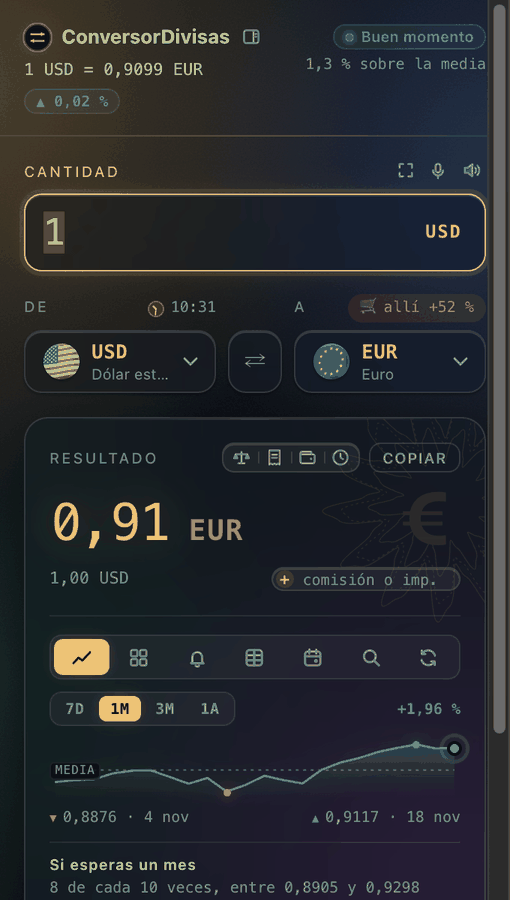

# ConversorDivisas

[](https://github.com/SergioCayetano232/ConversorDivisas/actions/workflows/tests.yml)

Extensión de Chrome para convertir divisas sin salir de lo que estés haciendo.

La hice porque me cansé de abrir una pestaña y buscar "euro a dólar" cada vez
que necesitaba una conversión rápida. Ahora es un clic en la barra del navegador.



## Qué hace

- **Convierte entre 55 divisas** escribiendo en cualquiera de las dos
  cantidades. También vale una cuenta: `20+15`, `3*12,50`, `100-15%`, `2k`
- **Pegas un precio con su divisa** ("1.299,00 £") y pone la cantidad y el par
- **En cualquier web**: seleccionas un precio y sale convertido al lado, con el
  clic derecho o con `Alt+Shift+C`. Sin seleccionar nada, convierte el del
  producto. Y si quieres, todos los precios de la página de una vez
- **Desde la barra de direcciones**: `cd 20 usd`
- **La tasa**: el gráfico de hasta un año, cuánto ha subido o bajado desde ayer,
  avisos cuando llega a donde tú digas y la tasa en el icono
- **Los gastos del viaje**: cada uno con la tasa de su día, por días y por
  categorías, con presupuesto, varios viajes y lo que hay que hacer antes de salir
- **Entre varios**: quién ha pagado, quién debe qué y el mensaje para cobrárselo
- **Lo de allí**, con los `cd`: la propina, el enchufe, el IVA, el visado, los
  teléfonos de emergencia, cómo se dice gracias
- **Medidas**: libras, millas, grados Fahrenheit, tallas de ropa y unas cuantas
  más raras
- **Tus datos**: copia de seguridad, importar los movimientos del banco o un
  grupo de Splitwise, y los ajustes sincronizados entre tus ordenadores
- En español y en inglés, en claro y en oscuro, en el popup o en el panel
  lateral, y con atajos de teclado para casi todo

Son más de cien cosas. La lista entera, con sus ejemplos, está en
[docs/funciones.md](docs/funciones.md).

## Instalación

No está en la Chrome Web Store, así que se carga a mano:

1. Descarga el repo (clonándolo o como ZIP)
2. Abre `chrome://extensions`
3. Activa el **Modo de desarrollador**, arriba a la derecha
4. Pulsa **Cargar descomprimida** y elige la carpeta del proyecto

El icono aparecerá en la barra. Si no lo ves, está escondido detrás del icono de
la pieza de puzzle.

Nada más cargarla se abre una pestaña de bienvenida: eliges tu divisa y el
idioma (se guardan al cambiarlos) y te enseña los tres atajos con las teclas que
Chrome ha puesto de verdad. Sola solo sale al instalar; para volver a ella,
`Ctrl+K` en el popup y escribes "mi divisa". Con tu divisa elegida, lo que
selecciones en una web o escribas en la barra (`cd 20 gbp`) se convierte a ella,
tengas el par que tengas puesto.

En las actualizaciones lo que sale es una estrella dorada en el pie del popup:
al pulsarla ves lo que trae la versión nueva, y al cerrarlo se va hasta la
siguiente. La lista está en `NOVEDADES`, en `logica/avisos.js`.

El tema sigue al sistema, pero se puede fijar en claro o en oscuro con el clic
derecho en el icono, en **Tema**. Vale para el popup, el panel lateral y las
demás páginas de la extensión; la tarjeta que sale en las webs sigue al sistema.

¿El atajo no funciona? Chrome no lo asigna si ya lo está usando otra extensión.
Se cambia en `chrome://extensions/shortcuts`.

## Cómo está hecho

JavaScript a pelo: sin frameworks, sin build y sin dependencias.

```
manifest.json    configuración de la extensión (Manifest V3)
popup.html       estructura del popup
popup.css        estilos
textos.js        todos los textos, en español y en inglés
tema.js          el tema a mano: va en el <head> de cada página
luz.js           la luz que sigue al ratón por las tarjetas de las páginas
logica/          las cuentas y los formatos, sin tocar la pantalla, por temas
logica.js        la puerta de los tests: junta los trozos de logica/
popup.js         lo que reacciona a los clics
copia.*          la página de la copia de seguridad (las opciones)
imprimir.*       la chuleta en tamaño tarjeta, para imprimir
bienvenida.*     la pestaña que sale al instalar: tu divisa, el idioma y los atajos
permiso.*        la pestaña que pide el micrófono para dictar
tique.*          la pestaña para elegir la foto del tique
fotos.js         las fotos de los tiques, en IndexedDB
background.js    el menú del clic derecho y la tasa para la tarjeta
tarjeta.js       la tarjeta que sale en la web, en un shadow DOM
precios.js       las pastillas con los precios de toda la página
test/            tests de la lógica
icons/           16, 48 y 128 px
docs/            la lista entera de funciones y el GIF de arriba
_locales/        el nombre y la descripción que enseña Chrome, en los dos idiomas
```

Lo que se puede probar solo está en `logica/`, aparte del resto. Los tests van
con lo que ya trae Node, así que no hay `node_modules` que instalar:

```
npm test
```

En cada push a `main` los corre también GitHub (`.github/workflows/tests.yml`);
la insignia de arriba dice si pasan.

Para lo demás, editas un archivo, le das a recargar en `chrome://extensions` y
ya está.

Las tasas vienen de [Frankfurter](https://frankfurter.dev), que es gratuita y no
pide API key. Las 30 del BCE van por su v1 y las otras 25 por la v2, que las saca
de otros bancos centrales; de esas no hay enchufes, emergencias, billetes ni
propina habitual, que prefiero no poner un teléfono que no sé si es bueno. Como el BCE publica una vez al día
laborable, el gráfico no tiene puntos en fines de semana ni festivos, y las
tasas guardadas valen hasta el día siguiente.

## Divisas soportadas

Primero las 30 que publica el BCE. Las de siempre:

EUR, USD, GBP, JPY, CHF, CAD, AUD, CNY, MXN, BRL, SEK, NOK, DKK, PLN y TRY.

Y detrás el resto:

CZK, HKD, HUF, IDR, ILS, INR, ISK, KRW, MYR, NZD, PHP, RON, SGD, THB y ZAR.

Y luego las que no publica el BCE, con tasa de su banco central:

VND, ARS, MAD, PEN, COP, CLP, EGP, AED, TWD, UYU, CRC, DOP, TND, KES, LKR, NPR,
KHR, JOD, QAR, SAR, GEL, RSD, BOB, GTQ y PYG. La de Cuba no está a propósito: su
tasa oficial no se parece a la de la calle.

Si el BCE añade alguna, basta con meter una línea en el array `DIVISAS_BCE` de
`logica/divisas.js`, con el nombre en español y en inglés (hay un test que comprueba
que la lista es justo la del BCE, así que habrá que tocarlo también). Las demás van en
`DIVISAS_MERCADO`. Para que
la tarjeta del clic derecho la reconozca por su símbolo o su nombre, va en
`PISTAS`, en el mismo archivo.

## Licencia

MIT. Haz lo que quieras con ello.
