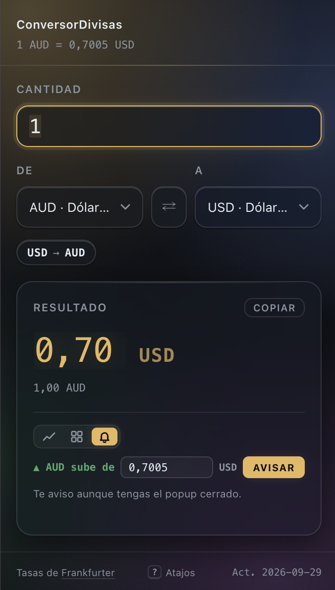

# ConversorDivisas

Extensión de Chrome para convertir divisas sin salir de lo que estés haciendo.

La hice porque me cansé de abrir una pestaña y buscar "euro a dólar" cada vez
que necesitaba una conversión rápida. Ahora es un clic en la barra del navegador.



## Qué hace

- Convierte entre las 30 divisas que publica el Banco Central Europeo
- Escribes en cualquiera de las dos cantidades y calcula la otra
- Puedes escribir una cuenta en vez de un número: `20+15`, `3*12,50`,
  `(40+60)/4` o `100-15%`. Mientras escribes te enseña el total, y al darle a
  Enter se queda con él. `2k` son dos mil y `1,5m`, millón y medio
- Precios por libra, onza o galón: escribes `3,99/lb` (o `0,25 oz`, `4,59/gal`,
  `1,99 fl oz`) y debajo del resultado sale lo que vale el kilo o el litro, en
  tu divisa ("≈ 7,82 EUR/kg"). Para todo lo demás cuenta como 3,99
- Si pegas un precio con su divisa ("1.299,00 £", "$49.99"), pone la cantidad
  y cambia la divisa a la vez. Pegado abajo, cambia la de destino
- Buscas la divisa escribiendo: pones "mex" y sale el peso mexicano
- Un botón para dar la vuelta al par sin tocar los dos desplegables
- Un botón para copiar el resultado. Con Shift (clic o `Shift+C`) copia la
  frase entera, "38,90 EUR = 42,79 USD", para mandársela a alguien. También
  se copia con doble clic en la cifra. Con Alt, con su símbolo: "42,79 $" o,
  en inglés, "$42.79". Si el símbolo lo comparten varias divisas, va el que no
  deja dudas (MX$, CA$, CN¥)
- Pulsando la tasa de arriba la ves al revés (`1 JPY = 0,005650 EUR`), que en
  la tienda muchas veces se piensa así. Se queda como la dejes. Debajo, cuánto ha
  subido o bajado desde el día anterior, en verde o en rojo. Si llevabas días
  sin abrirlo, al entrar te dice cuánto se ha movido desde entonces ("▲ 1,01 %
  desde el 1 oct, la última vez que miraste")
- Las últimas diez conversiones, en el reloj que hay al lado de **Copiar**. Pulsando
  una copias su resultado; con la flecha de al lado la vuelves a poner. Se
  apunta sola cuando dejas de escribir, al darle a Enter o al copiar
- Los gastos del viaje, en la cartera que hay al lado del reloj: con una
  cantidad puesta, le das a **+ 38,90 EUR** (con un concepto si quieres, "Cena",
  "Taxi"…) y se apunta. El concepto se completa con los que ya has usado
  (escribes "ca" y sale "Café", con su categoría), y lo aceptas con Tab o →. Si lo escribiste mal, pulsas el concepto y lo cambias. Con doble clic en la cifra copias el gasto, "Cena · 27,60 EUR (4.500,00 JPY)", para mandarlo suelto, y en el total, el del viaje ("Japón: 40,46 EUR en 3 días").
  Ahí mismo sale una tira con **Hoy**, **Ayer** y un calendario, para la cena
  que se te olvidó apuntar: el gasto se va a su día con lo que valía.
  Con las flechas de al lado lo vuelves a apuntar hoy, para el metro o el café
  de cada día, con la tasa de hoy. Arriba sale el total en tu divisa y lo que llevas de media
  al día, y debajo los gastos por días con lo de cada día y una barrita que dice cuánto pesa al lado del día que más. Entre
  dos días con gastos, los que no apuntaste nada salen a rayas ("🧘 2 días sin
  gastos"), por si se te olvidó algo. Cada uno se guarda con la tasa y la comisión de
  ese momento, así que lo que gastaste el lunes no cambia aunque el euro suba
  el martes. Hasta 200, y para vaciarlo hay que darle dos veces. Si
  quitas uno o los vacías todos sin querer, tienes cinco segundos para
  deshacerlo
- Modo discreto, con el ojo de arriba de los gastos: las cifras se difuminan
  para enseñar la pantalla sin que se vea lo que llevas. Pasando el ratón por
  una, se asoma. Se queda como lo dejes
- Buscar en los gastos con la lupa: escribes "taxi" y salen solo esos, con lo
  que coincide marcado y cuántos son y cuánto suman al lado. Busca también por
  la categoría, así que "comida" encuentra la cena aunque no lo pusieras. Y con
  el botón de las tres barras, del más caro al más barato, con una barra de
  fondo en cada uno que dice lo que pesa al lado del que más
- Varios viajes, cada uno con sus gastos y su presupuesto: pulsando el nombre
  del viaje, arriba del panel, cambias de uno a otro, ves cuánto llevas en
  cada uno y empiezas otro ("Japón", "Lisboa"). Se les cambia el nombre con el
  lápiz, y para borrar uno hay que darle dos veces. Con el botón de las dos
  hojas, al lado del +, empiezas uno como el que tienes abierto, con su
  presupuesto y la gente pero sin gastos, para la escapada que repites: empieza
  hoy y dura lo mismo. Hasta ocho. Lo que tenías
  apuntado antes de esto pasa al primero, sin perder nada
- Comparar los viajes: en esa misma lista, debajo de cada uno, lo que gastaste
  de media al día y en qué se fue más ("110,00/día · 🏨 80 %"), con una barrita
  medida contra el que más gasta al día. El más caro y el más barato llevan su
  marca. Va por días y no por el total, que una semana en Japón siempre suma
  más que un finde en Lisboa
- Cada viaje con su color (dorado, azul, coral, turquesa, lila o rosa): el panel
  de los gastos se tiñe del suyo, así sabes de un vistazo en cuál apuntas. Se
  cambia pulsando el puntito de delante del nombre, y el nuevo coge uno libre
- Cuántos sois: debajo del total, con el − y el +, y te dice lo que sale por
  cabeza. Va también en el resumen para WhatsApp ("Entre 3: 40,00 EUR cada uno")
- Si un gasto es cinco veces lo normal de su categoría, te avisa antes de
  apuntarlo ("11 veces lo normal en comida"), que un cero de más se cuela
  fácil. Para apuntarlo igual, le das otra vez. Lo mismo si apuntas otra vez
  lo que acabas de apuntar hace menos de dos minutos ("Este ya lo apuntaste
  hace 20 s"), que un doble clic sin querer descuadra el viaje
- El más caro de cada día lleva una corona 👑, y cuando otro le quita el
  puesto, cae y rebota
- El resumen del viaje para mandarlo: el bocadillo que hay al lado de **CSV**
  copia el total, lo más caro, el día que más, si el finde gastáis más que entre
  semana ("un 50 % más al día"), lo que más se repite ("🍽️ Café: 12 veces,
  38,40 EUR"), lo que se ha llevado el banco, en
  qué se ha ido, lo de cada día y cómo va el presupuesto,
  con negritas y emojis para que en WhatsApp se lea bien
- Cada gasto dice si fue con tarjeta o en efectivo, con el botón que hay al
  lado de la categoría. En efectivo no se le suma la comisión del banco, y en
  la lista lleva un puntito verde. Se queda como lo dejes. Arriba, con un
  puntito rojo, lo que llevas pagado en comisiones en el viaje, y con uno verde
  lo que te has ahorrado pagando en efectivo, con la comisión que tengas puesta
- A cuánto te ha salido el cambio en el viaje: debajo de las comisiones,
  "⇄ Cambio: 162,9 JPY", lo que te ha dado cada euro de media con la comisión
  dentro. Pasando el ratón, a cuánto te saldría hoy ("un 6 % más barato"), y
  va también en el resumen para WhatsApp
- El efectivo que te queda: pulsando la línea verde apuntas lo que sacas del
  cajero ("20k" son veinte mil) y los gastos en efectivo lo van descontando, en
  yenes y no en euros, que es lo que llevas en la cartera. Arriba pone "Quedan
  3.000 JPY", en dorado si te queda menos de una quinta parte y en rojo si has
  pagado más de lo sacado. Cada viaje con el suyo. Con presupuesto, te dice
  también cuánto sacar para lo que queda ("Saca 24.000 JPY para los 3 días que
  quedan"): lo que te toca al día, por la parte que sueles pagar en efectivo,
  menos lo que llevas, y redondeado a lo que da un cajero. Pulsándolo se pone.
  El último día y a la vuelta te dice lo que te sobra y lo que vale en tu
  divisa ("Te sobran 3.000 JPY ≈ 16,92"), para gastarlo o cambiarlo
- Cada gasto con su categoría (comida, transporte, alojamiento, ocio, compras
  u otros), que sale sola por el concepto ("taxi", "cena", "hotel") y se cambia
  con un clic. Arriba, en qué se te va el dinero en porcentajes; pulsando una
  ves solo esos gastos, y pasando el ratón, lo que llevas al día en ella
  ("Comida: 120,00 EUR, 30,00 al día")
- Un presupuesto para el viaje: le dices cuánto quieres gastar, qué día sales y
  hasta qué día (si aún no has salido, lo de al día se reparte entre los días del viaje),
  y una barra te enseña lo que llevas (verde, dorada pasado el 80 %, roja si te
  pasas) y cuánto te queda al día, también en la divisa de allí ("🇯🇵 ≈ 8.600
  JPY/día"), que es la de los precios que ves. Antes de apuntar un gasto, sale a rayas en
  la barra lo que se llevaría y cuántos días de presupuesto son ("≈ 0,6 días"). Al lado, en qué
  día del viaje vas ("Día 3/7"), y una marca en la barra con lo que llevarías
  gastado hoy yendo parejo: si la pasas, vas rápido. Detrás de lo gastado, una
  sombra hasta donde llegarás al acabar el viaje a este ritmo, en rojo si te vas a
  pasar, y pasando el ratón, cuánto ("acabarás gastando unos 735 EUR: te pasarás
  35"). Las noches de hotel ya apuntadas cuentan una vez, no dos. Cuando un gasto te lleva
  al 80 % o te pasas, te salta una notificación, y la barra da un latido con
  un brillo dorado. Arriba, una llamita con los días seguidos que llevas
  gastando lo que toca o menos ("🔥 3"), y un aro que se va cerrando con lo que
  llevas hoy contra lo que te toca hoy. Antes de salir, en vez del día del
  viaje, cuántos faltan ("✈ 12 días")
- El hotel por noches: si apuntas algo de alojamiento sale una fila con las
  noches, y con 5 se apunta un gasto por noche desde ese día ("1/5 · Hotel"),
  para que el día que pagas no parezca el más caro del viaje
- Al acabar un viaje sin pasarte del presupuesto, la primera vez que abres sus
  gastos sale confeti y lo que te ha sobrado
- Si estás de viaje y a las nueve de la noche no has apuntado nada, te lo
  recuerda con una notificación, una vez al día. Pulsándola se abren los gastos
  de ese viaje. Con clic derecho en el icono lo pasas a las ocho o a las diez,
  o lo quitas
- Las conversiones y los gastos se bajan en CSV con el botón **CSV** de cada
  panel, listos para abrir en Excel o en Google Sheets: en español van con
  punto y coma y "12,50", en inglés con coma y "12.50", y las tildes no se rompen.
  Los gastos llevan una columna con la comisión de cada uno. En la lista de
  viajes, **CSV** baja los de todos juntos, con el viaje en la primera columna
- Dividir la cuenta, en el tique que hay al lado de la cartera: con lo que
  pone la cuenta arriba, eliges la propina (sin, 10, 15, 20 % o la que quieras)
  y entre cuántos sois, y te dice lo que paga cada uno, en esa divisa y en la
  tuya. Se redondea hacia arriba al céntimo, para que en la mesa no falte nada.
  Puedes cambiar la cantidad con el panel abierto, y la propina y la gente se
  quedan guardadas. Debajo de la propina sale la que se suele dejar allí
  ("🇺🇸 Allí se suele dejar un 18 %"), y pulsándola se pone. Más abajo, con
  qué billetes lo pagas justo ("20 + 10 + 5 + 2,20") y, si no llevas suelto,
  con qué puedes pagar y cuánto te devuelven ("Pagas con 50: te devuelven
  12,80"). Arriba, con **+ 19,02 EUR**, apuntas tu parte en los gastos del
  viaje, propina incluida, y se queda en verde para que no la metas dos veces
- La comisión de tu banco: pones el % que te cobra la tarjeta (0, 1, 2, 3 o el
  que quieras) y al lado del resultado sale lo que pagarías de verdad. También
  va sumada en la chuleta y en las otras divisas. Se queda guardada para la
  próxima vez
- El impuesto de venta, en la misma burbuja que la comisión: en Estados Unidos
  y Canadá la etiqueta va sin él, así que pones el tuyo (5, 8, 10 % o el 8,875
  de Nueva York) y la pastilla te da lo que pasa por caja, con la comisión
  encima
- Cuántos cafés son: en esa misma burbuja pones lo que te cuesta un café en
  casa, y al lado de la cifra sale "☕ ≈ 30". Para hacerse a la idea
- Y cuánto trabajo es: pones lo que ganas a la hora y sale "⏳ 7 h", en
  minutos si es poco y en días de 8 horas si es mucho. Con los cafés puestos
  también, se turnan en el mismo sitio
- Dónde sale más barato, en la balanza que hay al lado del tique: con el precio
  de allí puesto arriba, escribes lo que cuesta aquí y te dice dónde te ahorras
  y cuánto ("Allí te ahorras 255,20 EUR, un 22 %"). La balanza baja hacia el
  lado caro. Lo de allí lleva tu comisión y tu impuesto, y por debajo de un 1 %
  lo da por igual
- Seleccionas un precio en cualquier web, clic derecho, **Convertir**, y te sale
  el resultado en una tarjeta al lado del texto. Entiende "1.299,00 €",
  "$1,049.99", "R$ 10,50" o "20 euros". Sin ratón, con `Alt+Shift+C` (`⌥⇧C`
  en Mac), también dentro de un campo de texto
- Todos los precios de una web a la vez: clic derecho en la página, **Convertir
  los precios de la página**, y al lado de cada precio sale lo que vale en tu
  divisa. Solo cuenta los que llevan la divisa pegada (`49,99 €`, `$1,049.99`,
  `USD 35`), así que un "20 unidades" no se convierte. Volviendo a darle, o con
  **Quitar**, la página se queda como estaba. Lo que la web va cargando
  después (el scroll infinito de las tiendas, el "ver más") también sale
  convertido, mientras las tengas puestas. Los precios con los céntimos en
  pequeño (`$49⁹⁹`) se los salta, que los leería mal
- Pastillas con tus últimos pares, para cambiar de uno a otro con un clic. Con
  la chincheta que sale al pasar el ratón fijas uno, y ese ya no se va aunque
  cambies mucho de par. Hasta tres
- Un gráfico de cómo ha ido la tasa, a 7 días, 1 mes, 3 meses o 1 año. Pasando
  el ratón ves la tasa de cada día, y marca el máximo y el mínimo del periodo.
  Pulsando un día (o con Enter) te lleva a la pestaña del día con esa fecha
- Si es buen momento para cambiar: arriba a la derecha sale "Buen momento",
  "Momento normal" o "Mal momento", según si la tasa de hoy es mejor que la de
  tres de cada cuatro días del periodo del gráfico, y cuánto se aparta de la
  media. En el gráfico, la media es la línea de puntos
- Qué día de la semana suele salir mejor, debajo del gráfico de 3 meses o de un
  año: "Los lunes suele darte un 0,09 % más que los jueves", con una barrita por
  día. Cada día se compara con la media de su semana, para que no gane el
  viernes solo porque la divisa vaya subiendo. Ya te digo que la diferencia es
  poca; con menos de dos meses de datos no lo enseña
- En la pestaña de al lado, la misma cantidad en otras divisas a la vez (hasta
  cinco, las eliges tú). Pulsando una la pones como destino. Detrás de cada una
  va un minigráfico de su última semana, verde si ahora te dan más que hace
  siete días y rojo si menos, con una flechita al lado del código; pasando el
  ratón ves el porcentaje. Con el botón de **WhatsApp** las copias todas, con su
  bandera ("🇯🇵 9.030,06 JPY"), para mandar en cuánto sale algo en cada sitio
- Una chuleta de viaje en otra pestaña: 1, 5, 10, 20, 50 y 100 en las dos
  divisas, para mirar precios de un vistazo. Si la divisa es muy pequeña (yenes,
  rupias…) empieza en 100 o en 10.000, que si no la tabla no sirve. Pulsando una
  fila la pones como cantidad. Abajo, el truco para hacerlo de cabeza en la
  tienda ("Quítale un 10 %", "Quita 3 ceros, × 6"), el más fácil que no se
  aparte más de un 4 %; pasando el ratón, cuánto se aparta. Con el botón de **WhatsApp** la copias en
  columna, lista para pegar en el grupo del viaje, y con **Imprimir** te la
  llevas en papel: sale del tamaño de una tarjeta de crédito, por un lado los
  precios de allí y por el otro lo que te dan por lo tuyo, para recortarla,
  doblarla y meterla en la cartera
- La tasa de un día concreto: eliges la fecha (o "hace 1 mes, 6 meses, 1 año")
  y te dice cuánto era tu cantidad entonces y cuánto ha cambiado hasta hoy. Si
  ese día fue fin de semana o festivo, te avisa y usa la del último día con tasa
- Si te cambian bien: en la pestaña de la lupa pones la tasa que te ofrecen en
  la casa de cambio o el cajero y te dice cuánto pierdes con tu cantidad, qué
  margen se quedan y si es "Bien", "Normal", "Caro" o "Te timan". Da igual
  que la escribas al derecho o al revés (`1 EUR = 1,10 USD` o `1 USD = 0,91
  EUR`), la entiende igual. Si tienes puesta la comisión de tu tarjeta, te dice
  qué te sale mejor
- La hora que es allí, al lado de la divisa de origen, con un relojito que la
  marca de verdad: si es de noche sale una luna, que estará todo cerrado.
  Pasando el ratón, la ciudad y cuántas horas te lleva
- La primera vez elige el par según el idioma del navegador: con `es-MX` empieza
  en MXN → USD, con `en-GB` en GBP → EUR. Si no lo tiene claro, EUR → USD
- Recuerda la última pareja de divisas, la cantidad, el periodo del gráfico,
  la pestaña y las divisas que tienes puestas
- Guarda las tasas del día, así que al abrirlo ya está el número puesto. Si
  la que tiene es de hace días (llevas tiempo sin conexión y el BCE ha
  publicado otras), al lado de la tasa sale "del lunes" en ámbar, y pulsándolo
  lo vuelve a intentar. Sabe que el BCE no publica los fines de semana ni en
  los festivos de TARGET, Semana Santa incluida. Abajo pone de cuándo es
  ("BCE hoy 16:00", a tu hora) y, pasando el ratón, cuándo sale la siguiente
- La tasa de tu par en el propio icono de la barra, en verde si ha subido desde
  el día anterior, en rojo si ha bajado. Se actualiza cada hora; si no la
  quieres, clic derecho en el icono y la quitas. Pasando el ratón por el icono,
  lo que llevas gastado hoy en el viaje ("Hoy llevas 42,00 de 100,00 EUR en
  Japón"), que cambia en cuanto apuntas algo
- Avisos de tasa: pones a cuánto quieres que llegue ("avísame si el dólar pasa
  de 1,15") y te salta una notificación cuando pase, aunque tengas el popup
  cerrado. Hasta cuatro a la vez. También vale un porcentaje: con "2 %" te
  avisa si se mueve eso para cualquier lado, y con "+2 %" o "-1 %", solo
  hacia ese. Debajo te dice en qué tasa saltará
- Se abre con `Ctrl+Shift+U` (en Mac, `Cmd+Shift+U`). Con clic derecho en el
  icono → **Gastos del viaje**, se abre directamente en los gastos
- Desde la barra de direcciones, sin abrir nada: escribes `cd`, espacio, y
  luego `20 usd`, `50 eur a gbp` o `100-15% jpy`. El resultado sale en las
  sugerencias de Chrome, con tus otras divisas debajo, y con Enter se abre el
  popup con esa conversión puesta. Con un `+` delante apuntas un gasto en el
  viaje abierto: `cd + 20 cena` o `cd + 1500 jpy taxi efectivo`. Usa tu
  comisión y cómo sueles pagar, salvo que pongas "efectivo" o "tarjeta". Y con
  `cd hoy` ves cómo vas sin abrir nada: lo de hoy, el total del viaje y lo que
  te queda del presupuesto. Con Enter se abren los gastos
- Atajos dentro del popup: `S` da la vuelta al par, `C` copia, `D` y `A` abren
  los desplegables, `G` los gastos, `/` busca en ellos, `E` cambia entre tarjeta y efectivo, `V` abre la lista de viajes, `P` dividir la cuenta, `B` la balanza, `R` las últimas conversiones, `Z` (o `Cmd+Z`, `Ctrl+Z`) deshace lo último que
  has quitado de los gastos y del `1` al `6` cambian de pestaña. Si estás escribiendo en
  un campo, con `Alt` delante (`⌥` en Mac). En la cantidad, `↑` y `↓` suben o
  bajan 1, y con Shift, 10. Con `?` salen todos
- Tiene modo claro y oscuro, según cómo tengas el sistema
- En español o en inglés, según el idioma de Chrome o el que elijas con clic
  derecho en el icono → **Idioma**. En inglés los números van a la inglesa
  (1,084.70), pero si escribes "12,50" también lo entiende
- Copia de seguridad: con el escudo que hay al lado de **Atajos** (o clic
  derecho en el icono → **Opciones**) se abre una página para bajarte en un
  archivo tus viajes, gastos, avisos, historial y preferencias, y para
  restaurarlos arrastrándolo. Antes de restaurar te enseña qué trae la copia,
  porque sustituye lo que tienes. Como la extensión se carga a mano, si borras
  la carpeta lo perderías todo
- Si algo falla te dice qué ha pasado, no se queda en blanco

Pide lo justo: guardar tus preferencias, hablar con la API de las tasas, una
alarma para refrescar el icono y mirar los avisos cada hora, mandar las
notificaciones de esos avisos, de los del presupuesto, del recordatorio de la
noche y de los gastos apuntados desde la barra y, para lo del clic derecho, el menú y poner la
tarjeta en la pestaña en la que estás.
Esto último solo pasa cuando pulsas **Convertir**, **Convertir los precios de
la página** o el atajo; no lee ninguna web por su cuenta, y por eso Chrome no avisa de nada al instalarla. No hay analítica ni
seguimiento de ningún tipo.

En Mac, para ver los avisos Chrome necesita permiso para mandar notificaciones
(Ajustes del Sistema → Notificaciones → Google Chrome).

En las páginas donde Chrome no deja meter nada (las de `chrome://`, la Web Store
o el visor de PDF) se abre el popup con la cantidad ya puesta.

## Instalación

No está en la Chrome Web Store, así que se carga a mano:

1. Descarga el repo (clonándolo o como ZIP)
2. Abre `chrome://extensions`
3. Activa el **Modo de desarrollador**, arriba a la derecha
4. Pulsa **Cargar descomprimida** y elige la carpeta del proyecto

El icono aparecerá en la barra. Si no lo ves, está escondido detrás del icono de
la pieza de puzzle.

¿El atajo no funciona? Chrome no lo asigna si ya lo está usando otra extensión.
Se cambia en `chrome://extensions/shortcuts`.

## Cómo está hecho

JavaScript a pelo: sin frameworks, sin build y sin dependencias.

```
manifest.json    configuración de la extensión (Manifest V3)
popup.html       estructura del popup
popup.css        estilos
textos.js        todos los textos, en español y en inglés
logica.js        las cuentas y los formatos, sin tocar la pantalla
popup.js         lo que reacciona a los clics
copia.*          la página de la copia de seguridad (las opciones)
imprimir.*       la chuleta en tamaño tarjeta, para imprimir
background.js    el menú del clic derecho y la tasa para la tarjeta
tarjeta.js       la tarjeta que sale en la web, en un shadow DOM
precios.js       las pastillas con los precios de toda la página
test/            tests de logica.js
icons/           16, 48 y 128 px
_locales/        el nombre y la descripción que enseña Chrome, en los dos idiomas
```

Lo que se puede probar solo está en `logica.js`, aparte del resto. Los tests van
con lo que ya trae Node, así que no hay `node_modules` que instalar:

```
npm test
```

Para lo demás, editas un archivo, le das a recargar en `chrome://extensions` y
ya está.

Las tasas vienen de [Frankfurter](https://frankfurter.dev), que es gratuita, no
pide API key y saca los datos del BCE. Como el BCE publica una vez al día
laborable, el gráfico no tiene puntos en fines de semana ni festivos, y las
tasas guardadas valen hasta el día siguiente.

## Divisas soportadas

Las 30 que publica el BCE. Primero las de siempre:

EUR, USD, GBP, JPY, CHF, CAD, AUD, CNY, MXN, BRL, SEK, NOK, DKK, PLN y TRY.

Y detrás el resto:

CZK, HKD, HUF, IDR, ILS, INR, ISK, KRW, MYR, NZD, PHP, RON, SGD, THB y ZAR.

Si el BCE añade alguna, basta con meter una línea en el array `CURRENCIES` de
`logica.js`, con el nombre en español y en inglés (hay un test que comprueba
que la lista es justo la del BCE, así que habrá que tocarlo también). Para que
la tarjeta del clic derecho la reconozca por su símbolo o su nombre, va en
`PISTAS`, en el mismo archivo.

## Licencia

MIT. Haz lo que quieras con ello.
